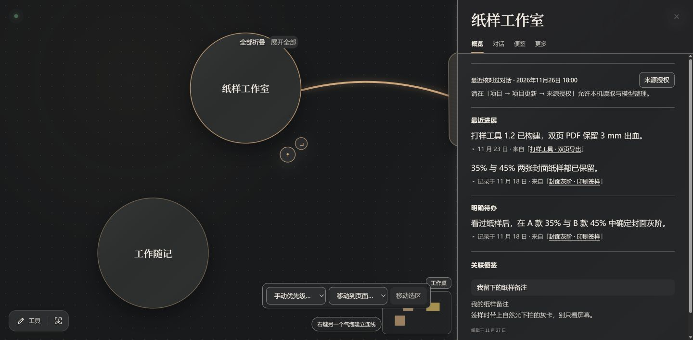

# ZZ Board · ZZ 都要干什么

<!-- 作者介绍起点：在这里打磨 README 首屏，导出后出现在公开仓库根目录。 -->

在一次猛蹬后的猛摆之后，突然发觉已经忘了自己之前都在干什么（bushi）....于是做了个小东西，想让它能自动简记 Codex 项目进展，也能方便围绕各个项目随手记一些 idea、问题和待办。想做得简洁、自由（在一片很大的空间乱涂乱画、乱堆乱放才是随手记的乐趣口牙！附：自用版本目前的便签缩略图.jpg）没什么出色的地方，但也用了很多本该干正事的时间来优化打磨了很多，希望它用着不烧心。

它同时保留了各种层面上DIY的空间，可以和agent哥磋商尝试。目前该项目之进行了对codex的支持，但源码公开，想要用在其他harness上大概也是一句话的事儿，也欢迎把做出的版本进行发布。其他各种反馈也都可以从项目设置内的入口或直接通过github进行发送
<!-- 作者介绍终点 -->

*虚构的春日书展样例。*

## 从 Codex 项目找回上次做到哪

同步后，一个 Codex 项目在画布上有一个气泡。悬停可以扫一眼近况，点开「概览」能看最近进展和明确待办。每条进展旁保留时间和对话出处，点标题能定位到看板里的对应对话，再从「在 Codex 打开」回到本机原对话。只记得标题的几个字，也可以从左上角「项目」搜索。

*「纸样工作室」的合成样例。打样工具已经构建，封面用哪张纸样还等人决定。*

项目同步后可以单独点「检查更新」，也可以让看板在运行时做每日检查。新看板默认关闭每日检查。本机读取与模型整理分别授权，模型整理使用你当前的 Codex 登录额度。以前保存的简报随时可以回看。

## 把对话里的决定留成一张手记

已经接入看板的话，可以在 Codex 项目里说「把刚才说定的封面方案和明早要比的两张纸样留成一张便签，先给我看看」。确认保存后，便签会连到对应项目，保留对话来源。下次打开项目的「便签」，可以直接读图文或回到画布上的位置。也可以在同一个 Codex 项目里让 Agent 再读这张便签，接着讨论。

*从「书展导览册 → 便签」找回之前连到项目上的封面纸样。*

## 在画布上随手写、画和摆

双击空白处就能写一张便签。贴图会插在正文里，长文可以原处滚动，也能双击进入专注阅读。便签和项目可以拖动、连线，空白处可以用画笔涂画。不同页面分别记住布局和视口，也可以专门留一页记自己的事。给便签加预期日期或标成「关注」「优先」，之后从画布上找回。画布、便签、图片和笔迹保存在本机。

## 和 Agent 一起换张纸

可以让 Agent 做一套适合夜里读长便签的 Skin，先看看正文、气泡和连线在实际样板里的效果。喜欢的话，可以整套换掉，也可以只换便签或背景。想改的是交互本身，就回到匹配版本的源码项目继续改。

*「灯下页边」的样板预览。左边可比较连线和优先级，右边可试读长文。*

## 发布进度

当前公开的是项目展示页。Windows 源码、部署指南和 GitHub Issues 将随首发开放。
