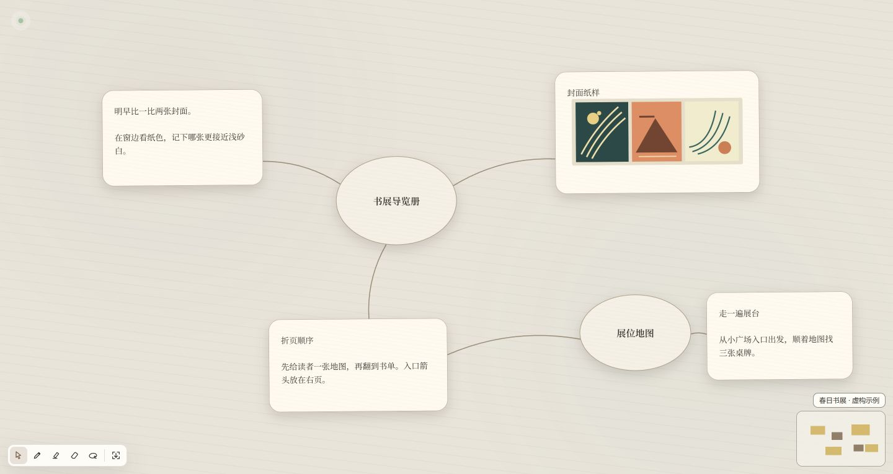

# ZZ Board · ZZ 都要干什么

在 Windows 本地画布上，找回 Codex 项目的进展和出处，随手记下想法、问题和待办。

在一次猛蹬后的猛摆之后，突然发觉已经忘了自己之前都在干什么（bushi）。于是做了个小东西，想让它能自动简记 Codex 项目进展，也方便围绕各个项目随手记下 idea、问题和待办。

想做得简洁、自由。在一片很大的空间乱涂乱画、乱堆乱放才是随手记的乐趣口牙！没什么出色的地方，但也用了很多本该干正事的时间来优化打磨，希望它用着不烧心。

它也留了不少 DIY 的空间，可以和 Agent 哥磋商着试。目前接好的是 Codex。想给别的 Harness 用，也可以找 Agent 一起改。

*虚构的春日书展样例。*

自用版的便签缩略图

## 和 Codex 项目一起用

- 同步后，一个项目对应一个气泡。打开它能看近况和待办，也能从简报的出处找到相应对话。
- 便签、图片和笔迹可以在画布上随手摆放、连到项目。也可以请 Codex 把对话里的决定存成带来源的便签，下次在项目里找回。
- 看板数据保存在本机。同步时可分别选择是否允许读取本机来源和使用模型整理。画布外观可以用 Skin 定制。

源码、部署指南和 GitHub 反馈入口将随 Windows 版首发开放。
