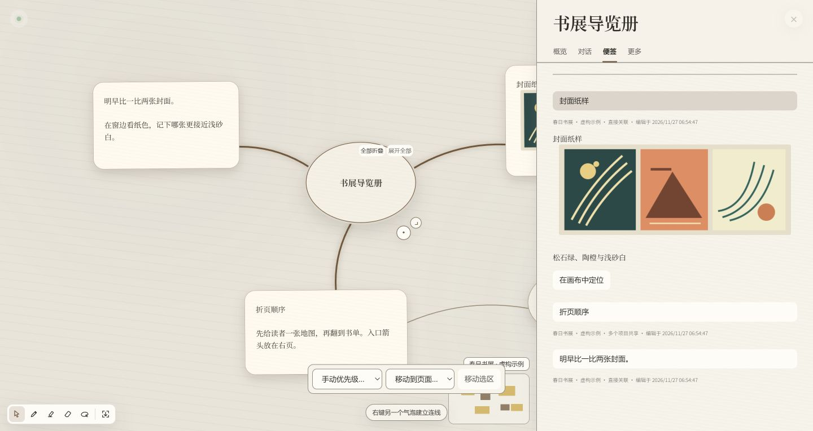
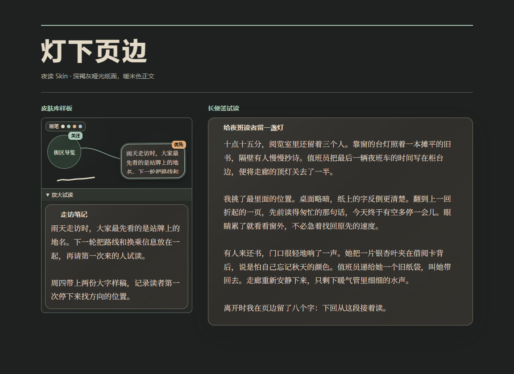

# ZZ Board · ZZ 都要干什么

<!-- 作者介绍起点：在这里打磨 README 首屏，导出后出现在公开仓库根目录。 -->

在一次猛蹬后的猛摆之后，突然发觉已经忘了自己之前都在干什么（bushi）....于是做了个小东西，想让它能自动简记 Codex 项目进展，也能方便围绕各个项目随手记一些 idea、问题和待办。想做得简洁、自由（在一片很大的空间乱涂乱画、乱堆乱放才是随手记的乐趣口牙！附：自用版本目前的便签缩略图.jpg）没什么出色的地方，但也用了很多本该干正事的时间来优化打磨了很多，希望它用着不烧心。

它同时保留了各种层面上DIY的空间，可以和agent哥磋商尝试。目前该项目只进行了对win的codex的支持，但源码公开，想要用在其他系统和harness上大概也是一句话的事儿，也欢迎把做出的版本进行发布。其他各种反馈也都可以从项目设置内的入口或直接通过github进行发送
<!-- 作者介绍终点 -->

图中数据是合成示例；不是外部用户案例。

## 从 Codex 项目找回上次做到哪

同步后，一个 Codex 项目在画布上有一个气泡。悬停可以扫一眼近况，点开「概览」能看最近进展和明确待办。每条进展旁保留时间和对话出处，点标题能定位到看板里的对应对话，再从「在 Codex 打开」回到本机原对话。只记得标题的几个字，也可以从左上角「项目」搜索。

*「纸样工作室」的合成样例。打样工具已经构建，封面用哪张纸样还等人决定。*

项目同步后可以单独点「检查更新」，也可以让看板在运行时做每日检查。新看板默认关闭每日检查。本机读取与模型整理分别授权，模型整理使用你当前的 Codex 登录额度。以前保存的简报随时可以回看。

## 把对话里的决定留成一张手记

已经接入看板的话，可以在 Codex 项目里说「把刚才说定的封面方案和明早要比的两张纸样留成一张便签，先给我看看」。确认保存后，便签会连到对应项目，保留对话来源。下次打开项目的「便签」，可以直接读图文或回到画布上的位置。也可以在同一个 Codex 项目里让 Agent 再读这张便签，接着讨论。

*从「书展导览册 → 便签」找回之前连到项目上的封面纸样。*

## 在画布上随手写、画和摆

双击空白处就能写一张便签。贴图会插在正文里，长文可以原处滚动，也能双击进入专注阅读。便签和项目可以拖动、连线，空白处可以用画笔涂画。不同页面分别记住布局和视口，也可以专门留一页记自己的事。给便签加预期日期或标成「关注」「优先」，之后从画布上找回。画布、便签、图片和笔迹保存在本机。

## 和 Agent 一起换张纸

可以让 Agent 做一套适合夜里读长便签的 Skin，先看看正文、气泡和连线在实际样板里的效果。喜欢的话，可以整套换掉，也可以只换便签或背景。想改的是交互本身，就回到匹配版本的源码项目继续改。

*「灯下页边」的样板预览。左边可比较连线和优先级，右边可试读长文。*

## 交给我的 Agent 部署

在 Windows x64 上，把这个仓库下载或克隆到一个打算长期保留的文件夹。在 Codex 中把这个文件夹作为本地项目打开，使用其他本地编程 Agent 也可以。把下面这段话交给它。

> 请把这个仓库作为我的 ZZ Board 项目，从源码构建并启动桌面版。如果这台电脑已经有看板，先找到原来的入口和数据，再接着使用。完成后，把能再次打开看板的入口和这个版本的作者介绍给我。以后我会回到这里，请你帮我做 Skin、改功能和维护它。

Agent 从仓库的工程说明开始，检查 Node、pnpm、Git、Rust/MSVC 与 WebView2，按构建结果核对实际窗口和服务。机器缺少工具时，它会先说明需要安装什么。看板数据保存在本机，普通部署无需云账号。[部署与再次打开](docs/DEPLOYMENT_QUICKSTART.md) · [给 Agent 的入口](AGENTS.md)

新建看板打开后直接进入「夜墨 3.0」画布。双击空白处写一张便签，或粘贴一张图。从托盘真正退出再打开，就能找回它。用左上菜单的「数据与帮助 → 使用指南」查操作。[三分钟试用](docs/USER_TRIAL.md) · [用户与 Agent 手册](docs/USER_AGENT_GUIDE.md)

第一次接入时，先打开桌面，让部署 Agent 运行 `pnpm setup:windows -- -BindCodex` 关联本机看板。到「项目 → 项目更新 → 来源授权」分别开启本机读取与模型整理。空白看板可以展开「从 Codex 同步更多来源」，复制同步指令到 Codex，发送前指定要同步的项目。同步后，打开一个项目气泡试试「检查更新」。[连接 Codex 的步骤](docs/DEPLOYMENT_QUICKSTART.md#连接-codex-项目)

## 下次在这个项目里继续

- **做一套 Skin。** 告诉 Agent 想要的纸面、边框和配色，例如「做一套夜里读长便签的暖灰纸样，先给我看预览」。项目里的制作 Skill 和校验工具可以直接使用。[外观与源码定制](docs/AGENT_CUSTOMIZATION.md)
- **维护和更新。** 让 Agent 先确认实际运行版本、数据目录和个人修改，备份后再更新。版本记录和工程导览随这份源码提供。[版本记录](CHANGELOG.md) · [工程导览](docs/ENGINEERING.md)

## 版本与许可

当前开放 **Windows x64 源码预览（0.11.0 / alpha.1）**，可按上面的指南自行构建。已完成自动检查、标准桌面构建与运行文件校验。这个候选的原生首用、中文输入与系统剪贴板、托盘退出重开和升级恢复仍待实测。

应用里的「反馈与帮助」可以预览、复制或保存报告。选择对应的 GitHub 表单，检查要公开的内容，再在 GitHub 确认提交。[报告问题](https://github.com/zh3zhou/zz-board/issues/new?template=bug.yml) · [提出建议](https://github.com/zh3zhou/zz-board/issues/new?template=feature.yml) · [隐私说明](PRIVACY.md) · [反馈与贡献](CONTRIBUTING.md) · [安全报告](SECURITY.md)

项目自有代码、文档及随附自有素材采用 **Source Available 1.0（源码可用）**，版权署名为李哲舟（Li Zhezhou）。允许个人和企业内部使用、免费社区 Fork、免费托管及独立收费的安装、培训和维护服务。核心软件收费分发与付费替代托管须另行授权。修改版分发须保留署名和相同许可。[项目许可](LICENSE) · [第三方材料](THIRD_PARTY_NOTICES.md)
